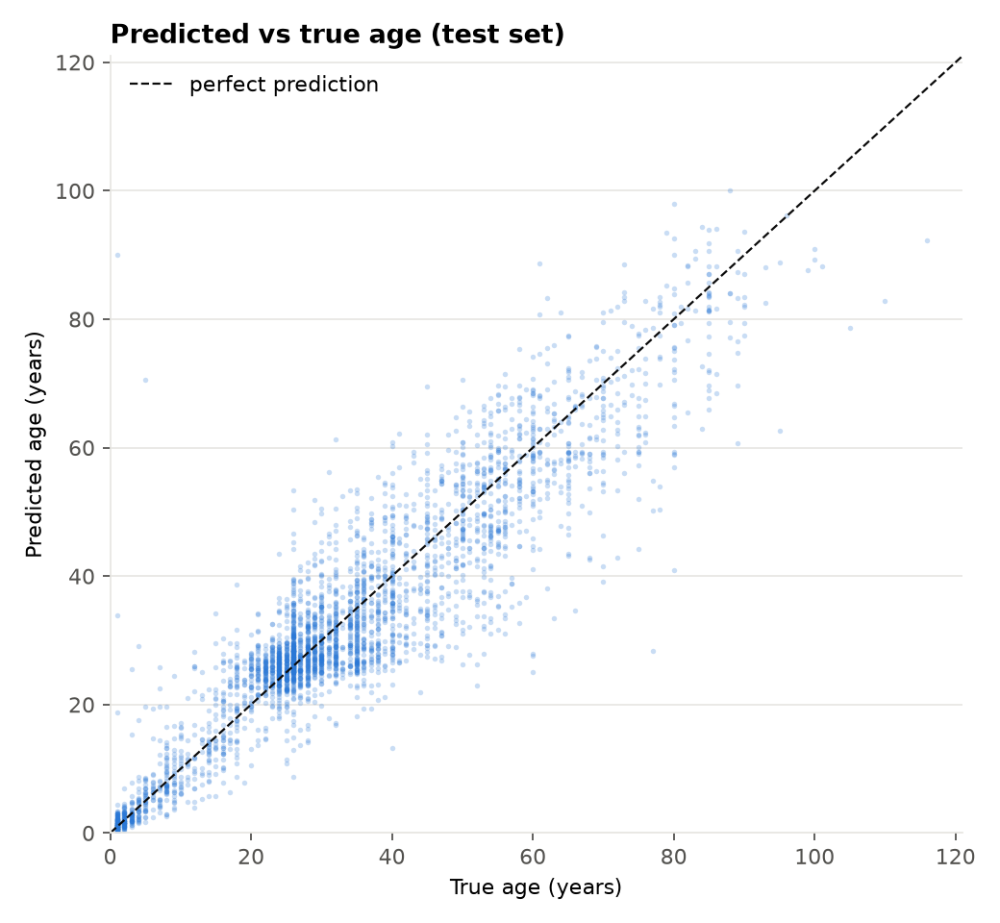
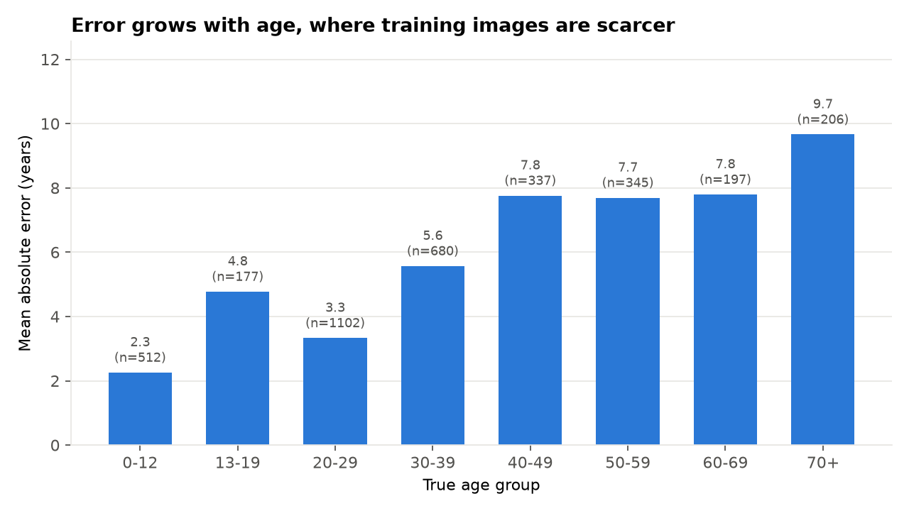
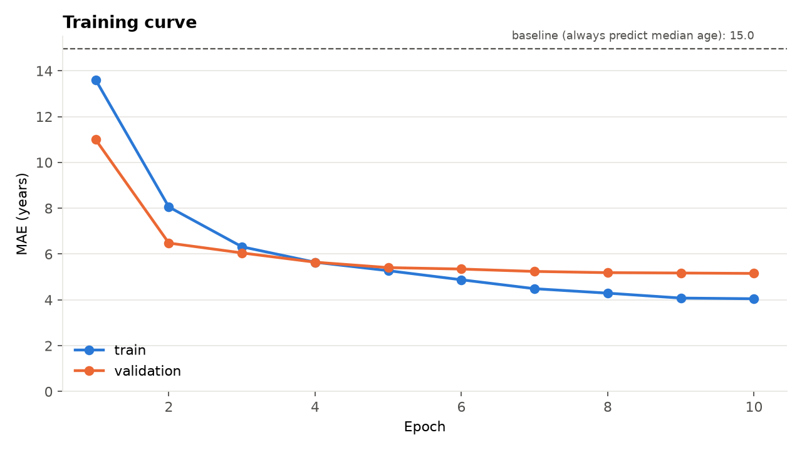

# Face Age Estimation – Transfer Learning with EfficientNet-B0

[](https://github.com/Mohamed-jarboui/face-age-estimation/actions/workflows/ci.yml)


Predicts a person's age from a face image. An ImageNet-pretrained **EfficientNet-B0** is fine-tuned as a regressor on the **UTKFace** dataset (23,700 faces aged 1 to 116). Training and evaluation run end to end on GitHub Actions, and results are reported on a held-out test set together with a naive baseline and error breakdowns by age, gender and ethnicity.

## Results

Held-out test set of **3,556 faces**, never used for training or model selection. Trained for 10 epochs (about an hour on a standard CPU-only GitHub Actions runner).

| | EfficientNet-B0 (this model) | Baseline: always predict the median age |
|---|---|---|
| **Mean absolute error** | **5.13 years** | 14.96 years |
| RMSE | 7.49 years | 20.28 years |
| Median absolute error | 3.51 years | 10.0 years |
| R² | 0.857 | −0.05 |
| Predictions within 5 years | 62.8 % | 34.6 % |
| Predictions within 10 years | 84.9 % | 50.6 % |

<p>
  
  
</p>

**Where the model struggles**

- **Older faces.** The error grows from 2.3 years for children (0 to 12) and 3.3 years for people in their twenties to 7.7 to 7.8 years between 40 and 69 and 9.7 years above 70. Older people are much rarer in UTKFace, so the model sees fewer examples of them.
- **Gender.** Similar error for women (4.95 years) and men (5.32 years); the test set is balanced (1,778 each).
- **Ethnicity.** MAE ranges from 3.5 years ("Others") and 3.9 years (Asian) to 5.6 years (White) and 5.9 years (Black). Most of this gap follows the age mix: the Asian and "Others" test groups are much younger on average (26 and 22 years, with many children), which makes them easier. Black faces have the highest error despite a middle-of-the-range average age (34), so age alone does not explain it; this is the first gap worth investigating.



After epoch 7, validation error improves very little (5.24 to 5.15 years) while training error keeps falling, so longer training at this resolution would bring small gains. Higher input resolution (this run uses 128×128 to keep CPU training under an hour) or a larger backbone are the more promising next steps.

Full numbers: [`results/metrics.json`](results/metrics.json) · per-image predictions: [`results/test_predictions.csv`](results/test_predictions.csv) · trained weights: [release `model-v1`](https://github.com/Mohamed-jarboui/face-age-estimation/releases/tag/model-v1).

## Approach

| Step | Choice | Why |
|---|---|---|
| Data | UTKFace aligned & cropped faces; age, gender and ethnicity parsed from file names | Standard public benchmark for age estimation |
| Split | 70 / 15 / 15 train / validation / test, **stratified by age group**, fixed seed | Every split has the same age distribution; the test set is never used for training decisions |
| Input | 128×128 RGB, ImageNet normalization | Keeps CPU training under an hour |
| Augmentation | Horizontal flip, brightness/contrast jitter, small shifts | Faces are roughly symmetric and centered |
| Model | EfficientNet-B0 backbone + 2-layer regression head (4.3M parameters) | Strong accuracy for its size; fast enough to train on CPU |
| Training | 1 epoch with the backbone frozen, then full fine-tuning; AdamW, one-cycle LR (backbone at 0.3× the head LR), Smooth L1 loss, early stopping on validation MAE | Warming up the new head first avoids destroying the pretrained features |
| Metrics | MAE (years), RMSE, R², share within 5 and 10 years; MAE by age group, gender and ethnicity | MAE is the standard age-estimation metric; the breakdowns show where the model is weaker |

## Project structure

```
├── src/age_estimation/
│   ├── data.py        # download, label parsing, stratified split, in-memory dataset
│   ├── model.py       # EfficientNet-B0 regressor
│   ├── train.py       # fine-tuning with early stopping
│   ├── evaluate.py    # test metrics, baseline, breakdowns, figures
│   └── predict.py     # predict the age of new images
├── tests/             # pipeline tests on synthetic images (no download needed)
├── results/           # metrics, training history, figures
└── .github/workflows/
    ├── ci.yml         # tests on every push
    └── train.yml      # full training + evaluation (manual run)
```

## Run it

```bash
git clone https://github.com/Mohamed-jarboui/face-age-estimation.git
cd face-age-estimation
pip install -r requirements.txt && pip install -e .

python -m age_estimation.train        # downloads UTKFace (~100 MB) and trains
python -m age_estimation.evaluate     # test metrics and figures in results/
python -m age_estimation.predict my_photo.jpg
```

The trained weights (17 MB) are published as a [release](https://github.com/Mohamed-jarboui/face-age-estimation/releases/tag/model-v1); download `model.pt` and `train_config.json` into `results/` to use `predict` without training. To retrain on GitHub's servers instead: **Actions → Train and evaluate → Run workflow**.

## Data and responsible use

- **Dataset:** [UTKFace](https://susanqq.github.io/UTKFace/) (Zhang, Song and Qi, CVPR 2017), downloaded from a [Hugging Face mirror](https://huggingface.co/datasets/py97/UTKFace-Cropped). It is released for non-commercial research. Face images are not stored in this repository.
- **Bias:** UTKFace is unbalanced: most images are of people aged 20 to 40, and some ethnic groups are under-represented. The per-group errors in the results above show how this affects accuracy.
- Apparent age from a photo is an estimate, not a fact about a person. This model is a learning project and should not be used for decisions about individuals.

## Author

Mohamed Jarboui – Data Science and AI engineering, École Polytechnique de Sousse
